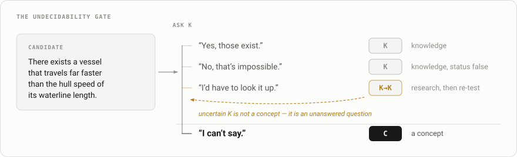
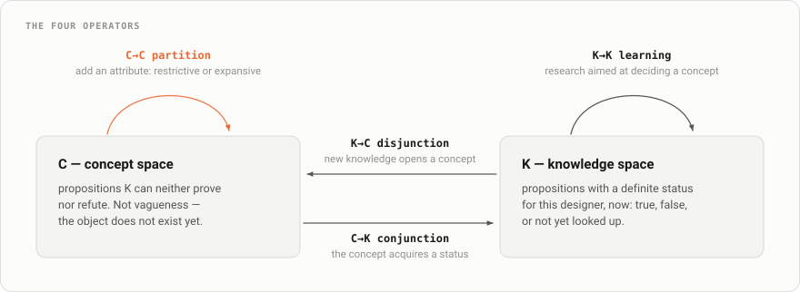
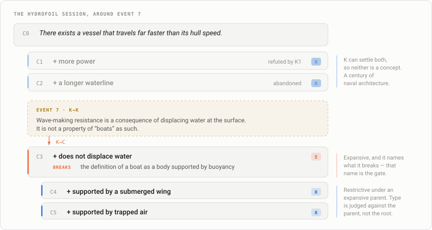
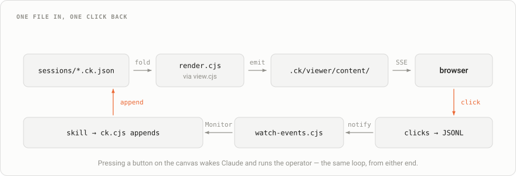
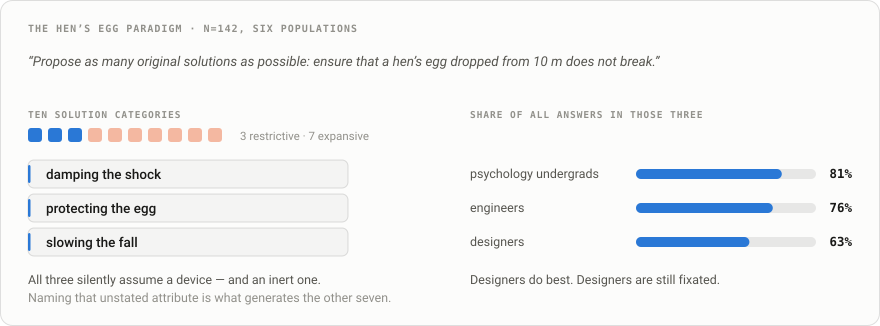
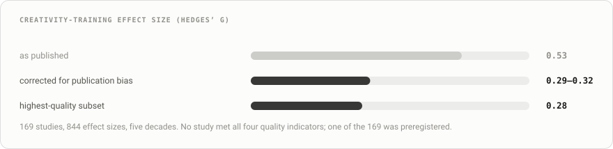

# C-K Studio

[](https://github.com/dbbz/C-K-studio/actions/workflows/validate.yml)
[](LICENSE)

An interactive tool for running **Concept–Knowledge design sessions** — a design theory
from Mines ParisTech (Hatchuel & Weil) — with Claude as the generating and challenging
half of the loop.

## What C-K is

Boats have a speed limit set by the length of their hull at the waterline. Ask how to
beat it and you will hear *more power* and *a longer hull*. Both are real answers. Both
are also answers your existing knowledge can already evaluate — which is precisely why
neither one invents anything.

C-K keeps two spaces apart and makes you say which one you are in.

**K — knowledge.** Propositions you can settle right now: true, false, or go look it up.
*"Near that limit, wave-making resistance rises with roughly the sixth power of speed."*

**C — concepts.** Propositions K **cannot** settle. Not vague, not impossible —
*undecidable*, because the object does not exist yet, so no amount of research will
resolve it. *"There exists a vessel that travels far faster than the hull speed of its
waterline length."*

You cannot research that second one into being true or false; you can only *design* it.
And when someone eventually does, hydrofoils exist: the proposition acquires a truth
value, becomes ordinary knowledge, and K has grown.

That is the entire engine. You expand C by adding an attribute to a concept — a
**partition** — you expand K by learning, and the two feed each other until a concept
lands in K. Designing *is* that co-expansion, and the theory's wager is that keeping the
two apart is what stops you circling the obvious.

The move that matters is a partition K cannot vouch for. *"+ a longer hull"* is
**restrictive**: K already knows hulls have lengths, so it merely selects among known
variants. *"+ does not displace water"* is **expansive**: K knows no such boat, and
accepting it forces you to revise what a boat *is*. Expansive partitions are where new
designs come from — and they are what every ideation method promises and few can
actually locate.

## The gate

Most things people call ideas are not concepts. They are requirements, preferences, or
questions nobody has looked up yet. So every candidate is put to K before it is allowed
into C:

<picture>
  <source media="(prefers-color-scheme: dark)" srcset="docs/gate-dark.svg">
  
</picture>

The third answer is the one that ruins C-K sessions. "Do lithium-air batteries work?" is
a literature search; "there exists a vehicle that stores no energy on board" is a
concept. Conflating them turns the whole exercise into brainstorming with extra
vocabulary.

This is what makes it not a brainstorm app, and the rules are enforced mechanically
rather than by good intentions: an expansive partition that fails to name the property
it breaks is rejected by `lib/ck.cjs`, not by a facilitator remembering to ask.

## Install

C-K Studio is a Claude Code plugin. From any session:

```
/plugin marketplace add dbbz/C-K-studio
/plugin install ck-studio@ck-tools
```

Then, in whatever project you actually want to think about:

```bash
ck new my-session --title "..." --brief "..."
ck view --open
```

Open the printed URL **including its `?key=…`** — the server rejects requests without
it. From there, talk to Claude or press the buttons on the canvas; both drive the same
loop.

Sessions are written to `sessions/` in your current directory rather than into the
plugin, so they live and get committed alongside the work they are about. Note that
while the plugin is enabled, `ck` shadows any other command by that name.

## In the Claude app

In the Claude app the canvas is a pane docked beside the conversation. It opens by
itself when the project's `sessions/` holds a session; `/ck-pane` opens it otherwise, or
again after you close it. In a project with no session yet, the pane holds a **Start a
session** button that asks Claude to start one.

It shows the same session the browser canvas does. Under the session and branch pickers
and the timeline, a map of the tree gives the overview, and you can hide it. Below that
the concepts are a tree of clickable rows: pick one and its card shows the partition,
the proposition, what it breaks, and the operators. The knowledge list puts the entries
that concept rests on first. Step the timeline back and the past is read-only here too:
a banner offers **Back to latest** and **Branch from here** in place of the operators.

A press becomes your next message to Claude, so you can read in the transcript what you
asked for:

```
ck-expand C6 on my-session (branch main) — pressed in the C-K pane
```

It starts a turn at once, or waits behind the one running, and the pane says what
Claude is working on until that turn ends.

While the pane has focus, `j` and `k` move between concepts, `h` and `l` step the
timeline, and `g` goes back to the latest step.

There is no server, URL or Monitor to start in the app: the pane reads `sessions/`
itself and redraws after every `ck` command. The browser canvas stays for the terminal
and for presenting a session.

While the pane is open, the plugin tells Claude so in the system prompt, and Claude
leaves the browser canvas alone unless you ask for it. Where an organization manages
Claude Code, a plugin you install yourself doesn't get to add to the system prompt, so
Claude isn't told and may start the browser canvas as well. That is harmless: both show
the same file.

## The operators

<picture>
  <source media="(prefers-color-scheme: dark)" srcset="docs/loop-dark.svg">
  
</picture>

| Skill | Operator | What it enforces |
|---|---|---|
| `ck-facilitate` | all | Runs the whole session as practitioner — sequencing, diagnosis, when to stop |
| `ck` | — | Session hub: start, resume, route, handle canvas triggers |
| `ck-frame` | — | The undecidability gate. Rejects requirements dressed as concepts |
| `ck-expand` | C→C | Negate constitutive properties; label every partition; name what it breaks |
| `ck-learn` | K→K, K→C | Research aimed at decidability, sorted into deciding / refuting / attribute-bearing |
| `ck-conjoin` | C→K | A conjunction requires new knowledge; a refutation climbs and re-partitions |
| `ck-defix` | — | Six fixation signatures, eight forcing moves, three rules from the evidence |
| `ck-map` | — | Render, assess, hand off |
| `ck-demo` | — | Loads the worked example and narrates it |

Skills are invocable as `/ck-studio:ck-frame`, `/ck-studio:ck-expand`, and so on.
`references/GRAMMAR.md` is the shared theory core they all read.

## What a session looks like

Run `/ck-studio:ck-demo` to see a finished one. That is the hydrofoil case: it copies
the worked example into your project and walks you to **event 7**, where the tree sits
at 0% expansive with both branches dead — which is what a century of naval architecture
looked like. Event 7 is the piece of knowledge that broke it open.

<picture>
  <source media="(prefers-color-scheme: dark)" srcset="docs/tree-dark.svg">
  
</picture>

Partition type is judged against the **parent** node, never the root. Once you accept a
non-displacing vessel, foils are a known means — so C4 is restrictive even though its
parent was expansive. That relativity is the part people get wrong most often.

Blue is restrictive and orange is expansive throughout, validated for colour-vision
deficiency and for contrast in both light and dark modes. Type also carries an `R`/`E`
badge, so it is never encoded by colour alone.

## Architecture

A session is an **append-only event DAG in one file**. Events carry a `parent` seq;
`branches` maps a name to the seq it points at. The tree and knowledge base are
*derived* by walking a branch to the root and folding it. Four things fall out of that
rather than being built: provenance (every event names the C and K it came from), the
timeline (folding the first *n* events of a chain is the state after *n* operations),
branches (a name pointing at an existing event — creating one copies nothing), and
auditability (the operator sequence *is* the file).

<picture>
  <source media="(prefers-color-scheme: dark)" srcset="docs/arch-dark.svg">
  
</picture>

**Bidirectional.** Canvas buttons don't just leave a note for later — `lib/watch-events.cjs`
runs under the `Monitor` tool and turns each press into a notification, so clicking
*partition* on a node wakes Claude and runs `ck-expand` without you typing anything. The
pane in the Claude app needs none of that path: a press there is submitted as your own
message.

**One fold, three runtimes.** `lib/view.mjs` holds pure functions (`chainOf`,
`divergence`, `foldEvents`, `metrics`, `renderTree`, `renderK`) used in Node for the
initial paint and serialised into the page for scrubbing and branch switching. The Node
tools are CommonJS, so they load `lib/view.cjs`, which `scripts/build-view.cjs`
generates from it. The pane imports the same functions from `lib/view.mjs`, so the
browser canvas, `ck show` and the pane cannot disagree about what a session holds. There
is no second implementation to drift out of sync.

**Tool and data are in different trees.** The plugin holds the code and the shared
theory docs; your project holds `sessions/` and `.ck/`. Every entry point takes that
split explicitly, and skills address the plugin side as `${CLAUDE_PLUGIN_ROOT}` and the
project side as bare relative paths.

**`lib/ck.cjs` is the only mutation path.** It enforces the invariants in `SCHEMA.md` —
an expansive partition without a `breaks` is rejected, and a conjunction without a
backing `C→K` entry is refused.

**The server is deliberately dumb**: serve the newest HTML, push a reload on change,
append clicks to JSONL. Zero dependencies, SSE rather than WebSockets.

## Time travel

The scrubber folds client-side, so rewinding is instant and read-only. Arrow keys step
one operation at a time.

Operator buttons are withdrawn while the scrubber is in the past, and replaced by a
branch hint. That isn't timidity: an event appended while rewound would still land at
the tip of the current branch, so the fold would present it as though it were made
knowing everything you had just scrubbed past — a provenance that never existed.
Branching gives you the line *with only the knowledge that existed at that point*,
which is the thing you actually wanted.

```bash
ck show my-session --at 7                # state after 7 operations
ck branch my-session alt --at 7          # a different route from there
ck branches my-session                   # list, with divergence
ck switch my-session main
```

Branching never rewrites history, and it copies nothing: `branches[name]` is just a seq
to start walking from, so two branches sharing a prefix share the same event objects.
Node ids are allocated across the whole file, so `C12` means the same concept in every
timeline and branches can be compared.

Since every branch ships inside the page, **switching timelines is a click in the
header**. The picker shows divergence as `@22 +1`: split at step 22, one step ahead
since.

## Files

| Path | |
|---|---|
| `bin/ck` | The `ck` command: resolves `lib/` relative to itself, leaves cwd alone |
| `lib/ck.cjs` | Event-DAG mutation CLI — branches and invariant enforcement live here |
| `lib/view.mjs` | Pure chain/fold/render functions: the one fold, shared by Node, the browser and the pane |
| `lib/view.cjs` | Generated from `lib/view.mjs` for the CommonJS tools — edit the `.mjs` |
| `lib/render.cjs` | Session → canvas HTML |
| `lib/ck-server.cjs` | Zero-dep viewer server (SSE reload + click capture) |
| `lib/watch-events.cjs` | Monitor script: canvas clicks → Claude notifications |
| `hooks/` | The pane: a Claude Code hooks module that draws the session in the Claude app |
| `types/index.d.ts` | The pane's `$.state` contract |
| `skills/` | The nine skills above |
| `references/GRAMMAR.md` | The operator grammar and the undecidability test |
| `references/TECHNIQUES.md` | Literature notes: which techniques have evidence, which do not |
| `SCHEMA.md` | Event log format and the five invariants |
| `scripts/build-view.cjs` | Writes `lib/view.cjs` from `lib/view.mjs` |
| `sessions/` | The worked example. *Your* sessions go in your own project, not here |

## Status

**Stage 1 (built): the solo core.** Full operator set, canvas (in the browser, and as a
pane in the Claude app), invariants, fixation detection, timeline, bidirectional
triggers.

**Stage 2 (not built): KCP workshop mode.** The Knowledge–Concept–Proposal protocol for
facilitated group sessions: K-sharing rounds, concept projectors, multi-participant
capture, presentable outputs.

**Stage 3 (not built): teaching mode.** A stricter tutor that explains *why* a proposed
partition is restrictive when you thought it was expansive.

Both reuse the same event log, so they are additive rather than a rewrite.

## Developing this repo

Install from the working copy, so edits to skills, `lib/` and the pane take effect where
you can see them:

```
/plugin marketplace add .
/plugin install ck-studio@ck-tools
```

Before pushing, run what CI runs:

```bash
claude plugin validate . --strict     # manifests and the pane's hooks; does NOT read skills/
node scripts/check-skills.cjs         # frontmatter, which the above misses
claude plugin test .                  # the pane's tests, hooks/*.test.ts(x)
for f in lib/*.cjs; do node --check "$f"; done
node --check lib/view.mjs
bash -n bin/ck lib/start-viewer.sh lib/stop-viewer.sh

node scripts/build-diagrams.cjs && git diff --exit-code docs/        # figures in sync
node scripts/build-view.cjs && git diff --exit-code lib/view.cjs     # fold in sync
```

`version` appears in both `.claude-plugin/plugin.json` and the marketplace entry; keep
them equal or `--strict` will say so.

The figures in `docs/` are generated — edit `scripts/build-diagrams.cjs`, not the SVG.
It emits a light and a dark file per figure from one source, so the two themes cannot
disagree, and GitHub picks between them with `<picture>`.

`lib/view.cjs` is generated too — edit `lib/view.mjs` and rerun
`scripts/build-view.cjs`. The pane cannot load CommonJS, and the Node tools cannot assume
a Node new enough to `require` an ES module, so each gets the format it can load from
one source.

`tsconfig.json` type-checks the pane against the declarations Claude Code lays in
`.claude-plugin/types/` (gitignored): `npx -y -p typescript@5.6 tsc -p .`. Claude Code
lays them only when a session loads the plugin from this folder as a watched one
(`claude --plugin-dir .`), not for an installed copy, so run one such session first.

## From the research notes

`references/TECHNIQUES.md` is a literature sweep, kept so the skills encode what the
evidence supports rather than what gets repeated about C-K. A few things out of it — not
a summary, and not exhaustive.

<picture>
  <source media="(prefers-color-scheme: dark)" srcset="docs/fixation-dark.svg">
  
</picture>

Children proposed wrapping the egg in foil. No adult did — ten-year-olds know what
parachutes are, but that knowledge was never activated. Fixation is a failure of
**activation**, not of possession, which is why injecting knowledge works at all.

| Finding | |
|---|---|
| Your own first idea fixates you harder than an external example does | Which inverts the usual worry about showing people examples |
| Experts fixate as much as novices — and cannot tell | Chess masters who reported searching for alternatives were still eye-tracking the familiar move |
| "Avoid the obvious solution" mostly does nothing | Best-powered test, N=303: exposure to examples changed output, exposure to instructions did not |
| Random-word prompts are null to harmful | Pre-registered, N=592. A structured eight-field sweep beat a random-word arm head to head |
| Provocation works as an artefact, not an instruction | And earliest is strongest — it belongs *before* the first idea, not held back for when the room stalls |
| Nobody reliably picks their own best idea | Generation and selection fail independently, so fixing generation alone buys nothing |

A large part of the file is what the evidence *doesn't* support — including about C-K
itself, and about this tool's own premise. It lands on a number everything else has to
be calibrated against:

<picture>
  <source media="(prefers-color-scheme: dark)" srcset="docs/calibration-dark.svg">
  
</picture>

Small and real. No skill here should promise more.
